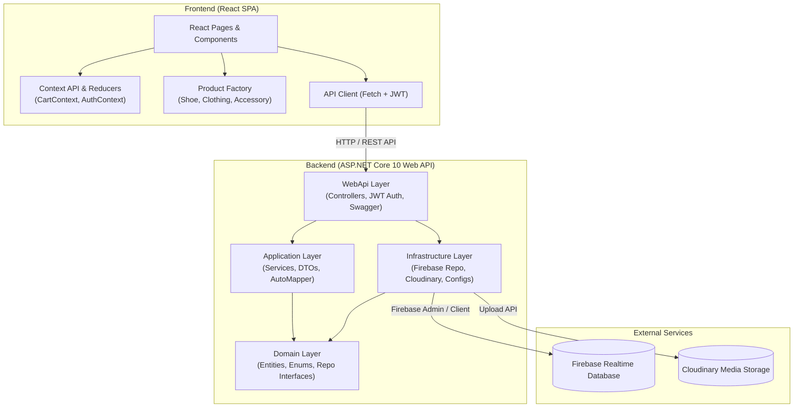

# 1
team / BalanceDevs
project / New Balance Store
team members:
 - [Олексій Єлісєєв - TL / front - @zadrotiik](github.com/AlexElNX)
 - [Микита Габер - back - @ZemNyux](github.com/ZemNyux)
 - [Олексій Драціон - full-stack / jira - @bobr0980](github.com/AlexDrts)
 - [Данило Павлюк - QA / technical writer - @goyvey](github.com/kasatjk)
# 2
problem: inconvinient websites, hard and too slow to find clothes, too much friction with accounts etc
solution: sleek, modern UI, smooth UX, easy purchase in a couple of clicks even without reg
target audience: people 14-60+-, those who prefer comfortable clothes, those who need sportswear etc
# 3
[srs](https://github.com/AlexElNX/NewBalanceStore/blob/main/docs/src.md)

90%+ reqs satisfied, specific amount will be shown on presentation
# 4
[UI kit](/ui-kit.html)
Competitors:
 - [original NB website](https://www.newbalance.com/)
 - [P43 group similar project](github.com/vicitmceo/NewBalanceShop)
 - etc
# 5

# 6
```mermaid
graph CleanArch
        subgraph Backend
              WebApi["WebApi Layer<br/>(Controllers, JWT Auth, Swagger)"]
              App["Application Layer<br/>(Services, DTOs, AutoMapper)"]
              Domain["Domain Layer<br/>(Entities, Enums, Repo Interfaces)"]
              Infra["Infrastructure Layer<br/>(Firebase Repo, Cloudinary, Configs)"]
        
              WebApi --> App
              App --> Domain
              Infra --> Domain
              WebApi --> Infra
end
```
# 7
Factory, Repository, Reducer, DI
# 8
--- will be added
# 9
 - most or 100% reqs satisfied
 - tests: 95% blocks, 90.1% lines
 - 51 unit tests, 10 integration tests
 - 101+ commit
 - 2 months develompent
# 10
 - [jira dashboard (to be updated)](/dashboard.pdf)
 - [branches example](branches.png)
 - branches: main, tests, docs...
 - [contributors](contributors.png)
# 11
NUnit 51 unit and 10 integration tests. 90%+ coverage. 100% pass
(visual studio analysis)[tests.png]
# 12
 - data: firebase firestore and auth
 - backend: .NET 10, ASP.NET Core, swagger
 - frontend: react, vite
 - tests: NUnit, vitest, WebAppFactory, coverlet
 - version control and deploy: git, github.com, render.com, docker
 - teamwork: jira, scrum technique
# 13
[🌐 Live Frontend](https://balancedevs.onrender.com/) &nbsp;|&nbsp; [📚 GitHub Репозиторій](https://github.com/AlexElNX/NewBalanceStore) &nbsp;|&nbsp; [📑 Документація API (Swagger)](https://newbalancestoreback.onrender.com/swagger) &nbsp;|&nbsp; [📄 Документація проєкту (DocFX)](https://zemnyux.github.io/NewBalanceStoreBack/index.html)
# 14
email and password
# 15
Valuable experience and portfolio project:
 - full development cycle
 - cooperation
 - working deploy available for anyone
 - modern tools
Target audience potential:
 - easy purchasing without reg
 - project scalability
 - comfortable UI/UX
Monetization:
 - payment integration after financial tech course
 - etc
# 16
contacts (again)
# 17
Main thought: придумаємо разом пізніше :)
